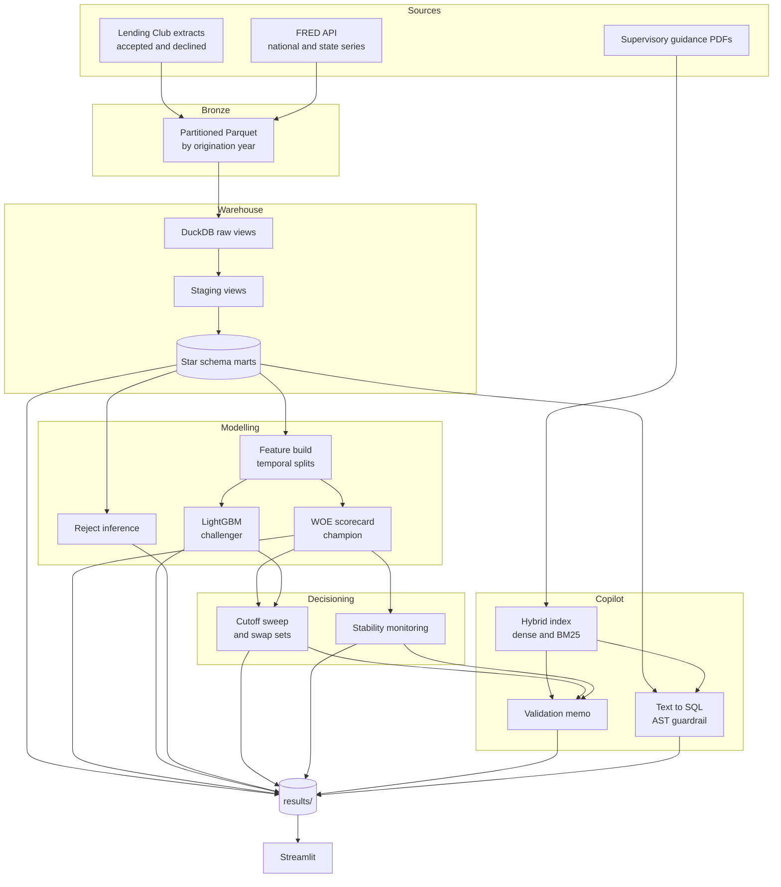
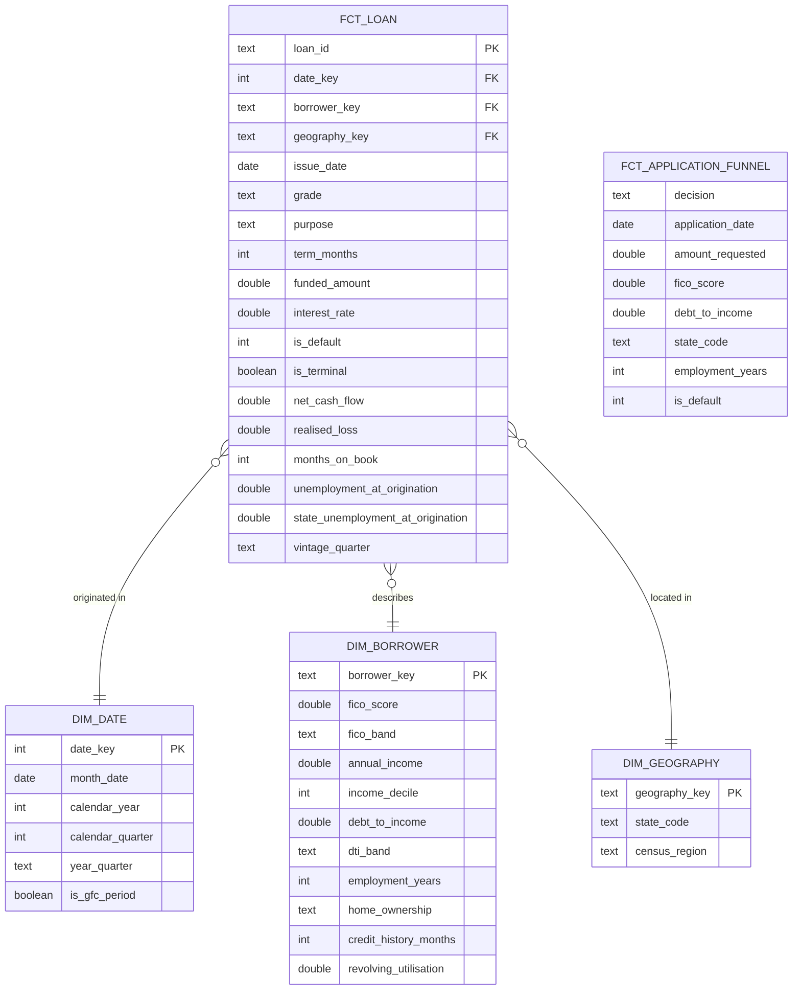

# CreditFlow

A credit risk analytics and decisioning platform built on the Lending Club
book. It ingests roughly thirty million loan applications and live
macroeconomic series into a dimensional warehouse, models the probability of
default with a regulatory-style scorecard and a gradient-boosted challenger,
converts model output into an approve-or-decline policy under stated unit
economics, monitors whether the applicant population has moved far enough to
invalidate that policy, and exposes the whole thing through a copilot that
answers questions in natural language and drafts model governance documentation
grounded in published supervisory guidance.


## What this answers

**Which origination vintages underperformed, and was it the economy or the
underwriting?** Cohorts are compared at equal months on book, so a young
vintage is never scored against a seasoned one. Quarter-on-quarter movement in
the default rate is then set against the change in risk-grade mix and the
change in state unemployment at origination, which separates a book that took
on worse applicants from one that wrote the same applicants into a worse
economy. → [`results/tables/macro_attribution.csv`](results/tables/), [`results/tables/vintage_curves.csv`](results/tables/)

**What approval rate maximises expected profit?** Expected profit per
application is built from calibrated default probability, exposure, loss given
default, funding cost, operating cost and a prepayment haircut, then swept
across the full range of cutoffs rather than reported at one. The frontier
matters more than its peak: the curve is usually flat near the top, which means
several approval rates are close to optimal and the choice among them is a risk
appetite decision. → [`results/tables/cutoff_sweep_challenger.csv`](results/tables/)

**Is a model fitted on the development window still safe to deploy?** The
Population Stability Index is computed per feature and on the model score,
using bin edges fixed on the development sample — the detail that makes the
measurement mean anything, since recomputing quantiles per period returns
roughly zero no matter how far the population moved. The score-level row is the
one that decides it: features can drift and offset each other, but a moving
score means the approved population changed without anyone authorising it.
→ [`results/metrics/psi_report.csv`](results/metrics/)

**Does the gradient-boosted challenger hold its advantage out of time?** Both
models are fitted on loans through 2015, tuned on 2016 and scored on 2017
onward, with the challenger's probabilities isotonically calibrated so the
comparison is about ranking rather than level. The swap-set analysis then holds
approval volume equal and asks which applications each model approves that the
other declines, which answers the question an AUC comparison cannot: is the
challenger ranking better, or just differently?
→ [`results/metrics/`](results/metrics/), [`results/tables/swap_set_analysis.csv`](results/tables/)

**How much does the accepted-only sample understate through-the-door risk?**
The declined applications are scored with a scorecard deliberately restricted to
the five attributes both extracts publish, then carried as fractional good and
bad observations rather than hard labels. The rejection penalty this rests on
cannot be estimated from the data, so the result is reported across a range of
penalty values and a reader can take their own view.
→ [`results/tables/reject_inference.csv`](results/tables/)

## Architecture



## Data model



The grain of `fct_loan` is one funded loan. `fct_application_funnel` sits at a
different grain — one application, approved or declined — and stacks both
populations on the attributes the two source extracts have in common, which is
what makes reject inference possible at all.

Every macro attribute on the fact is point-in-time as at the origination month.
The join is an equality on the month key, never a nearest-match or a forward
fill, and a dbt singular test recomputes the expected value independently and
fails the build on any mismatch. A loan originated in March 2015 carries March
2015's unemployment rate and nothing later.

## Results

Every artifact is regenerated from source by `make all` and lands in
`results/`. Nothing in there is committed except the directory structure — the
repository tracks the code that produces results, not the results themselves,
so a clone reproduces all of them rather than inheriting someone else's run.

| Directory | Holds |
|---|---|
| `results/metrics/` | Model performance by split, information values, stability measurements, optimal cutoffs |
| `results/tables/` | Vintage curves, macro attribution, segment profitability, approval funnel, cohort retention, cutoff sweeps, swap sets, reject inference sensitivity |
| `results/figures/` | Calibration curve, feature attribution, profit frontier, warehouse lineage |
| `results/governance/` | Model validation memo, text-to-SQL benchmark |

[`results/README.md`](results/README.md) documents each artifact: what it
contains, its schema, and which command produces it.

## Stack

| Tool | Role | Why this one |
|---|---|---|
| Polars | CSV to Parquet conversion | The lazy scanner streams the extract, so peak memory stays flat regardless of file size. Pandas would need the whole file resident before writing anything. |
| DuckDB | Warehouse | Reads Parquet in place and pushes filters into the scan, so registering the bronze layer costs nothing and no data is duplicated. A server-based warehouse would add an operational dependency to a project that runs on one machine. |
| dbt | Transformation and testing | Data quality tests live next to the models they constrain and run in the same command, so a broken assumption fails the build rather than surfacing three stages later in a model metric. |
| optbinning | WOE binning | Enforces monotonic bins directly. Hand-rolled binning gets the mechanics right and the monotonicity constraint wrong, which is the part that makes a scorecard defensible. |
| scikit-learn | Scorecard and calibration | Logistic regression over WOE-transformed features keeps per-attribute point contributions readable, and isotonic calibration corrects probability level without disturbing the ranking. |
| LightGBM | Challenger | Handles categorical splits natively and fits the full training window in minutes, so the champion-challenger comparison is cheap enough to rerun whenever an assumption changes. |
| SHAP | Challenger attribution | The nearest available answer to why a boosted model scored an application the way it did. It approximates what the scorecard gives exactly, which is precisely the trade-off being measured. |
| ChromaDB and BM25 | Retrieval | Embeddings catch paraphrase, BM25 catches the exact terminology supervisory text turns on. Fusing on rank rather than score avoids calibrating two incomparable scales. |
| sqlglot | SQL guardrail | Parses generated SQL into a syntax tree that can be reasoned about structurally. A keyword blocklist is bypassable through comments and string literals, and rejects safe queries that merely mention a forbidden word. |
| Streamlit | Front end | Reads the generated artifacts rather than recomputing anything, so opening the app never triggers a model fit. |
| Dagster | Orchestration | Assets declare their real dependencies, so a change rebuilds only what it invalidates. Each asset shells out to the same entry point the Makefile calls, keeping one execution path. |

## Quickstart

```bash
python3.11 -m venv .venv && source .venv/bin/activate
cp .env.example .env        # add a FRED key and a Gemini key
make setup
```

Obtain the source extracts as described in [`docs/data.md`](docs/data.md), then:

| Command | Produces |
|---|---|
| `make ingest` | Partitioned Parquet under `data/parquet/`, registered as DuckDB views |
| `make build` | The dbt staging views and star schema marts, with all data quality tests run |
| `make analysis` | The five analytical result sets in `results/tables/` |
| `make model` | Feature splits, both scorecards, the calibrated challenger, reject inference sensitivity, and the metric files and figures for each |
| `make decide` | Cutoff sweeps, swap sets, the profit frontier chart, and the stability report |
| `make rag` | The retrieval index, the text-to-SQL benchmark, and the validation memo |
| `make app` | Serves the Streamlit front end |
| `make test` | The test suite |
| `make all` | Every stage above, in order |

The test suite runs against synthetic fixtures and needs no data downloaded, so
`make test` works on a fresh clone.

## Repository structure

```
creditflow/
├── analysis/              five analytical queries and the runner that exports them
├── app/                   Streamlit front end
├── data/                  extracts, Parquet and the warehouse file (untracked)
├── dbt_creditflow/
│   ├── models/staging/    typed views over the raw sources
│   ├── models/marts/      star schema dimensions and facts
│   └── tests/             singular tests, including the point-in-time guards
├── docs/                  data sources, modelling, decision framework, governance
├── orchestration/         Dagster asset graph
├── rag/                   retrieval index, SQL guardrail, copilot, memo generator
├── results/               every generated artifact
├── src/
│   ├── ingest/            Lending Club and FRED loaders, warehouse registration
│   ├── features/          feature build with the leakage assertion
│   ├── models/            scorecard, reduced scorecard, challenger, reject inference
│   ├── decision/          cutoff optimisation and swap sets
│   └── monitor/           population stability
└── tests/                 metrics, leakage controls, SQL guardrails
```

## Design decisions

**A scorecard is champion, not the gradient-boosted model.** I chose a
monotonic WOE scorecard as the deployed model and kept LightGBM as a challenger
even where it discriminates better. I rejected the alternative — champion the
best-performing model and explain it post hoc with SHAP — because of what has
to happen when an application is declined. The lender owes the applicant a
reason and a validator a derivation, and a scorecard gives both by
construction: each attribute contributes a fixed number of points, the decline
reason is the attribute whose points fell furthest below neutral, and the model
fits on one page. SHAP approximates that; it does not replace it. The scorecard
also enforces monotonicity, so a better attribute value can never increase
modelled risk — a property a tree ensemble will violate wherever the training
data suggests it, and one that has to hold for a policy to survive challenge.
What the challenger contributes is the bound: how much discrimination the
constrained form actually costs, measured honestly.

**Splits are temporal, not random.** I split on origination year — train
through 2015, validate on 2016, test on 2017 onward — and rejected a random
split despite it being simpler and producing better headline numbers. Under a
random split the model trains on 2018 loans while scoring 2016 loans, which is
a condition production never offers. The deeper problem is that a random split
draws train and test from the same population by construction, so it cannot
detect drift: the two samples are the same sample, shuffled. Since the whole
point of the stability report is to measure how far the applicant population
moved between development and deployment, a random split would guarantee that
measurement returned nothing regardless of what actually happened.

**The declined applications are in the warehouse.** I included the declined
extract and built `fct_application_funnel` across both populations, rather than
modelling on funded loans alone as almost every treatment of this dataset does.
The accepted file is the only source of labels and it is a biased sample —
every row passed a policy screen. A model fitted on it estimates the default
rate conditional on approval and reports it as though it described everyone who
applied, so any future policy that approves differently faces a population the
metric never described. Carrying the declined side means that bias can at least
be quantified. I rejected hard-labelling the declined applications as bad,
which would encode the incumbent policy's judgment as ground truth, in favour
of parcelling them as fractional observations under a stated rejection penalty
reported across a range.

**Probabilities are calibrated, not just ranked.** I fitted isotonic regression
on the validation window rather than using the raw model output, because the
decision engine multiplies predicted probability by exposure and loss given
default to get expected loss. That arithmetic needs a probability, not a
ranking. A model can rank perfectly and still be systematically wrong about
level, and one reporting every probability at twice its true value produces a
flawless ordering and a wrong cutoff. Isotonic regression corrects level while
preserving order, so the discrimination metrics are untouched and the
probabilities become usable. I fitted it on validation rather than test, since
calibrating on the sample used to report calibration measures nothing.

**Results are isolated from source.** Every script writes to `results/` and
nowhere else, with all output paths deriving from one constant per module. The
directory structure is tracked and its contents are not. I rejected the more
common arrangement of scattering CSVs and figures next to the code that
produces them, because it makes two things impossible to answer: whether a
given number came from the current code or a run three weeks ago, and whether a
clone actually reproduces the work or merely inherits someone else's output.
One output root means `make all` is the only way a result comes into existence.

## Limitations

Months on book is derived from the last recorded payment date, not from a
payment schedule. For a loan that prepaid, this measures when repayment
finished rather than how long the loan was contractually alive, so the vintage
curves should be read as cumulative incidence and not as a hazard rate. Cohort
retention mixes charge-off with prepayment and full repayment for the same
reason.

Loss given default is fixed at 65% rather than modelled. In practice it varies
with time on book at default, with balance outstanding, and with the
collections environment of the vintage. A loan charging off in month four has
repaid almost nothing; one charging off in month thirty has returned a
substantial fraction of principal. A constant understates the first and
overstates the second, and it is the assumption the optimal cutoff is most
exposed to.

Reject inference rests on a rejection penalty that cannot be estimated from
this data. The sensitivity table reports the result across a range of values
instead of defending one, but no value in that range is derived — they are all
assumptions, and the conclusion is only as good as whichever one a reader
accepts.

The prepayment haircut is flat across all loans. Prepayment is not uniform: it
concentrates in the strongest borrowers refinancing into better rates, which is
precisely the population a tighter cutoff retains. A flat factor therefore
understates revenue at loose cutoffs and overstates it at tight ones, biasing
the recommended approval rate upward.

There is no roll-rate analysis, because the data does not support one at this
grain. Roll rates need month-by-month delinquency states, and the extract
publishes a single terminal status per loan with no intermediate history. The
vintage curves are the closest available substitute and they answer a narrower
question.

The decision framework optimises expected profit on one cohort under fixed unit
economics. It models no capital requirement, no concentration limit, no funding
cost that scales with book size, and no competitor response. It also treats
applications as independent, so it says nothing about correlated losses when a
downturn hits the whole book at once — which, given that the macro features
exist because that correlation is real, is its most conspicuous gap.

## License

MIT. See [LICENSE](LICENSE).
